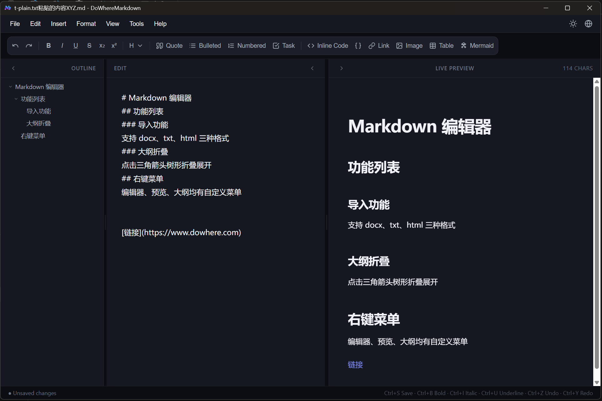
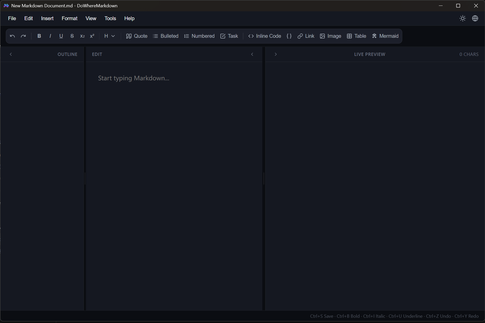
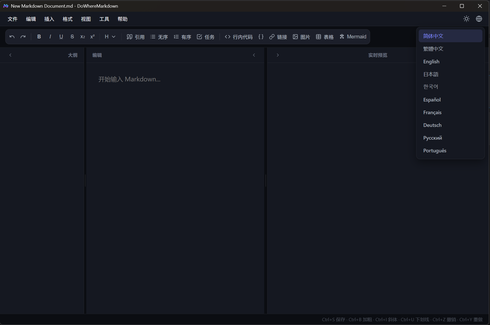

# DoWhereMarkdown

<p align="center">
  
</p>

<p align="center">
  <a href="README.md">English</a> | <a href="README_CN.md">简体中文</a>
</p>

**DoWhereMarkdown** is a clean, efficient desktop Markdown editor — write on the left, see the live preview on the right. It is built with Tauri 2 and a build-tool-free front end of plain HTML/CSS/JavaScript. Every third-party library is bundled locally, so it **works fully offline**.

<p align="center">
  
</p>

- Version: 0.1.0
- Platform: Windows 10 / 11 (NSIS installer)
- Author's blog: <https://www.dowhere.com>

---

## Features

### ✍️ Editing and live preview

- Two-pane layout (editor + preview) with three modes: "editor + preview", "editor only", and "preview only"
- Renders as you type, with synchronized scrolling between the editor and preview
- Collapsible panes and a draggable splitter for adjusting pane width
- Undo / redo history (up to 100 steps)
- Find and replace (`Ctrl+F` / `Ctrl+H`)

### 📝 Markdown syntax

- Headings H1–H6, bold, italic, underline, strikethrough, superscript / subscript
- Blockquotes, ordered / unordered lists, GFM task lists
- Inline code and fenced code blocks
- Links, images, tables, horizontal rules
- **Syntax highlighting for 30+ languages** in code blocks (highlight.js)
- **Math formulas** (KaTeX): `$...$` inline, `$$...$$` block
- **12 Mermaid diagram types**: flowchart, sequence, class, state, ER, user journey, Gantt, pie, mindmap, timeline, Git graph, and quadrant chart; the insert dialog offers a live preview

### 🗂️ Outline navigation

- Headings are parsed from the **Markdown source** directly (`#` inside fenced code blocks is correctly excluded, and Setext headings are supported)
- Indented by level; clicking a heading jumps to it in both the editor and the preview
- The current section is highlighted automatically as you scroll the editor or preview
- Tree-style collapse / expand of child headings via the arrow next to each heading
- Panel width is draggable, and the collapsed state persists across sessions

### 📂 Files, import, and export

- **File operations**: new, open, save, save as, recent files (up to 8, stale entries pruned automatically), open containing folder, exit
- **Multiple encodings**: UTF-8, GBK, GB18030, Big5 (both reading and writing use the selected encoding)
- **Import**: Markdown, TXT, HTML, DOCX
  - DOCX is converted with mammoth (headings, bold/italic, lists, tables, and images are preserved)
  - HTML is filtered down to its body content and converted to Markdown
- **Export as**:
  - Markdown (.md)
  - Word (.doc)
  - PDF (.pdf) — generated by headless rendering with the system's Microsoft Edge, not through a print dialog
  - HTML (.html, a self-contained page)
  - PNG image — five aspect ratios: 9:16, 4:5, 3:4, 1:1, 16:9
- Files and images can be **dragged straight into the window**: documents open, images are inserted into the text

### 🌐 Web page to Markdown

- Choose "Tools → Web to MD", enter a URL, and the page body is fetched and converted to Markdown
- On the desktop app the request is made from Rust (reqwest), so browser CORS restrictions do not apply
- Redirects are followed automatically, and the page is decoded according to its charset (GBK and others supported)
- The conversion preserves images (including lazy-loaded ones), links, tables, nested lists, task lists, and code blocks; relative paths are resolved to absolute URLs

### 🖼️ Image handling

- When pasting or choosing an image you can either **embed it as Base64** or **save it to a local folder**
- In local mode, files are named by timestamp (`image-{timestamp}.png`) and inserted with an absolute path

### 🌍 Interface and experience

- **10 interface languages**: Simplified Chinese, Traditional Chinese, English, Japanese, Korean, Spanish, French, German, Russian, Portuguese
- One-click light / dark theme switching
- **Context menus tailored to each area** (editor, links / images in the preview, outline, text inputs, empty space)
- External links in the preview open in the system browser instead of navigating the app window
- **Save prompt on close**: unsaved changes trigger a "Save / Don't save / Cancel" confirmation
- The current file name is shown live in the window title (`file name - DoWhereMarkdown`)
- Full-screen toggle (`F11`)

---

## Screenshots

A fresh document — the interface is available in 10 languages:

<p align="center">
  
</p>

Switching the interface language:

<p align="center">
  
</p>

---

## Tech stack

| Part | Technology |
| --- | --- |
| Desktop framework | Tauri 2.x (`withGlobalTauri`; the front end calls native APIs through `window.__TAURI__`) |
| Backend language | Rust (std::fs for file I/O, reqwest + rustls for web fetching, encoding_rs for encoding conversion) |
| Tauri plugins | dialog (native open / save dialogs), opener (open links / file locations), clipboard-manager (clipboard) |
| Front end | Plain HTML / CSS / JavaScript, single file, no build step |
| Markdown parsing | marked + marked-highlight |
| Code highlighting | highlight.js (30+ language packs) |
| Math | KaTeX 0.16.9 |
| Diagrams | Mermaid 10.9.8 |
| DOCX parsing | mammoth 1.12.3 |
| Image export | dom-to-image-more |

> All front-end dependencies live in `src/vendor/` and are loaded locally. Nothing is fetched from a CDN, whether running or packaging.

---

## Project structure

```
.
├── package.json               # Only depends on @tauri-apps/cli
├── make_icon.py               # Generates the Tauri app icons from logo.png
├── logo.png                   # Product logo
├── images/                    # Screenshots used by the READMEs
├── src/                       # Front end (frontendDist points here in tauri.conf.json)
│   ├── index.html             # The app: markup + styles + all application scripts
│   ├── logo.png
│   └── vendor/                # Localized third-party libraries and language packs
│       ├── i18n.js            # UI strings for the 10 languages
│       ├── marked.min.js
│       ├── marked-highlight.umd.js
│       ├── highlight.min.js
│       ├── lang-*.min.js      # highlight.js language definitions
│       ├── katex.min.js / katex.min.css
│       ├── fonts/             # KaTeX woff2 fonts
│       ├── mermaid.min.js
│       ├── mammoth.browser.min.js
│       └── dom-to-image-more.min.js
└── src-tauri/                 # Rust backend and packaging configuration
    ├── Cargo.toml
    ├── build.rs
    ├── tauri.conf.json        # Tauri config (window, bundle targets, security policy)
    ├── capabilities/
    │   └── default.json       # Window / dialog / clipboard permission declarations
    ├── icons/                 # App icons (PNG / ICO / ICNS at all sizes)
    └── src/
        └── lib.rs             # Native commands: file I/O, web fetching, PDF via Edge
```

The `#[tauri::command]` functions exposed by the Rust side:

| Command | Purpose |
| --- | --- |
| `read_text_file` | Read a text file using the given encoding |
| `save_text_file` | Write a text file using the given encoding (.md / .doc / .html) |
| `save_binary_file` | Write a binary file (.png) |
| `save_image_file` | Save an image to the given folder named by timestamp; returns the absolute path |
| `fetch_web_page` | Fetch a web page's source (follows redirects, decodes by charset) |
| `html_to_pdf` | Render HTML to PDF using Microsoft Edge in headless mode |

---

## Requirements

- Windows 10 / 11
- [Node.js](https://nodejs.org/) (development only; 18+ recommended)
- [Rust](https://www.rust-lang.org/tools/install) toolchain (stable)
- Microsoft Edge (bundled with Windows 10/11; **only needed for PDF export**)
- The first `tauri build` downloads the NSIS toolchain automatically (requires network access once)

---

## Getting started

### 1. Install dependencies

```bash
npm install
```

### 2. Run in development

```bash
npm run tauri dev
```

This opens a WebView2 development window. Edit `src/index.html` and refresh the window to see your changes.

### 3. Build the installer

```bash
npm run tauri build
```

When the build finishes, the NSIS installer is at:

```
src-tauri/target/release/bundle/nsis/DoWhereMarkdown_0.1.0_x64-setup.exe
```

### 4. Open directly in a browser (no install)

Because the front end is a pure static page, you can also open [src/index.html](src/index.html) in a browser and use editing, preview, import, and web-to-Markdown (behind a proxy) right away. Only the desktop-only capabilities are unavailable — recent files, open containing folder, native save dialogs, and direct PDF export; export falls back to a browser download / print.

---

## Keyboard shortcuts

| Shortcut | Action |
| --- | --- |
| `Ctrl + N` | New document |
| `Ctrl + O` | Open file |
| `Ctrl + S` | Save (writes straight back to the existing file if there is a path) |
| `Ctrl + Shift + S` | Save as |
| `Ctrl + Z` | Undo |
| `Ctrl + Y` | Redo |
| `Ctrl + B` | Bold |
| `Ctrl + I` | Italic |
| `Ctrl + U` | Underline |
| `Ctrl + K` | Insert link |
| `Ctrl + Shift + K` | Insert image |
| `Ctrl + F` | Find |
| `Ctrl + H` | Replace |
| `F11` | Toggle full screen |
| `Tab` | Indent |

---

## Usage

### Menu bar

- **File**: new, open, import, recent files, save, save as, preferences, export as, encoding, open containing folder, exit
- **Edit**: undo, redo, find, clear
- **Insert**: code block, link, image, table, Mermaid, task list
- **Format**: bold, italic, underline, strikethrough, superscript/subscript, H1–H6, blockquote, list, inline code
- **View**: layout mode, full screen, outline panel toggle
- **Tools**: web to MD
- **Help**: help, about

The far right of the menu bar holds the **theme switcher** and **interface language** icons.

### Preferences

"File → Preferences" lets you configure:

- Image handling (embed as Base64 / save to a local folder) and the image folder
- Interface language
- Default layout and default encoding
- Whether to prompt for unsaved changes when closing the window

### About PDF export

PDF export renders the document as a self-contained HTML file (with all styles and KaTeX fonts inlined) and then calls the system's Microsoft Edge in headless mode with `--print-to-pdf` to produce the PDF directly — no print dialog ever appears. If the export fails, check that Microsoft Edge is installed.
